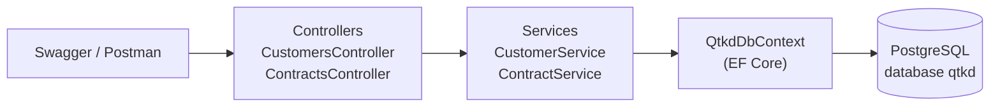

# Các thành phần chính của solution

| Thành phần | Vai trò |
|---|---|
| Controllers | Nhận request HTTP, trả response và mã trạng thái |
| Services | Xử lý nghiệp vụ (tuần 06 sẽ đặt CTR-01, CTR-02, CTR-03 và Submit ở đây) |
| Data (`QtkdDbContext`) | Truy cập dữ liệu, cấu hình quan hệ, migration, dữ liệu mẫu |
| Entities | Các lớp ánh xạ bảng: Customer, Contract, ContractAttachment, PriceList, PriceItem, ApprovalRequest, ContractHistory |
| Dtos | Dạng dữ liệu trả ra ngoài, tránh lộ entity và lỗi vòng lặp JSON |
