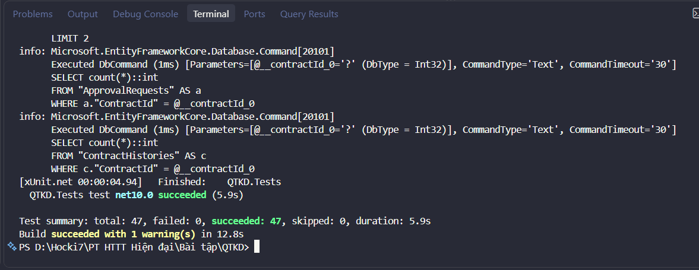
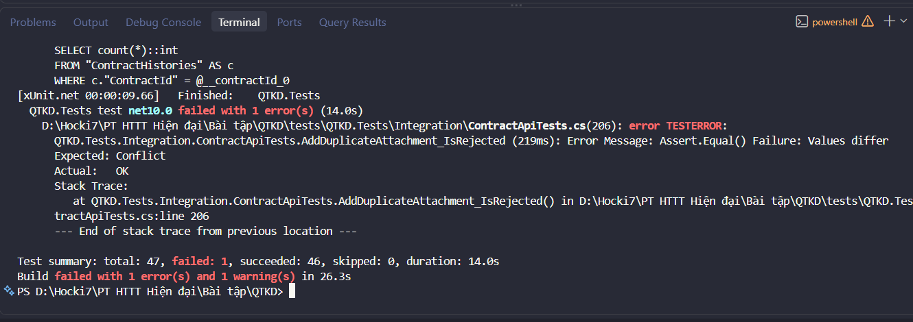

# Báo cáo kiểm thử (tuần 07)

## 1. Cách chạy

```bash
dotnet test                                   # toàn bộ test
dotnet test --filter "Category=Unit"          # chỉ unit test
dotnet test --filter "Category=Integration"   # chỉ integration test
dotnet test --logger "trx;LogFileName=results.trx" --results-directory docs/evidence
```

- **Unit test** (`tests/QTKD.Tests/Unit`): kiểm tra các quy tắc CTR-01, CTR-02, CTR-03 trong `ContractRules`, không dùng database.
- **Integration test** (`tests/QTKD.Tests/Integration`): chạy API thật trong bộ nhớ (`WebApplicationFactory`), gọi bằng HTTP và đối chiếu dữ liệu trong **database kiểm thử riêng** `qtkd_test`. Mỗi lần chạy, bộ test xóa và tạo lại database này bằng migration, nên không ảnh hưởng database `qtkd` chính.
- Mỗi integration test kiểm tra đủ ba thứ: mã HTTP, nội dung trả về và dữ liệu trong database sau khi gọi, không kết luận thành công chỉ vì API trả 200.

## 2. Bảng TC01-TC08

Toàn bộ test tự động (47/47) đều chạy thành công trên môi trường kiểm thử.

| TC | Dữ liệu/thao tác | Kết quả mong đợi | Cách kiểm thử | Test tương ứng | Kết quả |
|---|---|---|---|---|---|
| TC01 | Tạo Customer hợp lệ | Tạo được và đọc lại từ DB | Tự động (integration) | `CustomerApiTests.TC01_CreateValidCustomer_IsCreatedAndReadableFromDatabase` | Pass |
| TC02 | Tạo Customer thiếu thông tin bắt buộc | Bị từ chối, có thông báo lỗi | Tự động (integration, 3 ca: null, rỗng, khoảng trắng) | `CustomerApiTests.TC02_CreateCustomerWithoutName_IsRejected_AndNothingIsSaved` | Pass |
| TC03 | Sửa Contract ở Draft | Thành công khi dữ liệu hợp lệ | Tự động (integration) + unit CTR-01 | `ContractApiTests.TC03_UpdateDraftContract_Succeeds`, `ContractRulesTests.Ctr01_EditableStatus_IsAllowed` | Pass |
| TC04 | Sửa Contract ở PendingApproval | Bị từ chối, dữ liệu giữ nguyên | Tự động (integration) + unit CTR-01 | `ContractApiTests.TC04_UpdatePendingApprovalContract_IsRejected_AndDataUnchanged`, `ContractRulesTests.Ctr01_NonEditableStatus_IsRejected` | Pass |
| TC05 | Submit Contract thiếu điều kiện CTR-02 | Bị từ chối, vẫn là Draft | Tự động (integration + unit) | `ContractApiTests.TC05_SubmitContractMissingCtr02Conditions_IsRejected_AndStaysDraft`, `ContractRulesTests.TC05_Ctr02_SeveralProblems_AreAllReported` | Pass |
| TC06 | Submit Contract hợp lệ | Chuyển sang PendingApproval | Tự động (integration) | `ContractApiTests.TC06_SubmitValidContract_MovesToPendingApproval` | Pass |
| TC07 | Thử chuyển Draft thẳng Approved | Bị từ chối | Tự động (unit). Không có endpoint đổi trạng thái tùy ý nên không kiểm thử qua API | `ContractRulesTests.TC07_Ctr03_DraftToApproved_IsRejected` | Pass |
| TC08 | Submit lặp một Contract | Không tạo thêm kết quả xử lý trùng | Tự động (integration, gồm cả trường hợp hai yêu cầu đồng thời) | `ContractApiTests.TC08_SubmitTwice_DoesNotCreateDuplicateApproval`, `ContractApiTests.TC08b_ConcurrentSubmit_OnlyOneSucceeds` | Pass |

Không có test nào phải chạy thủ công. Lý do chưa tự động hóa: không có.

### Minh chứng kết quả kiểm thử toàn bộ (Pass 47/47)



## 3. Test bổ sung

| Test | Mục đích |
|---|---|
| `Ctr01_AddAttachmentToPendingApprovalContract_IsRejected` | CTR-01 cũng áp dụng khi thêm tệp đính kèm |
| `Ctr02_SubmitContractOfInactiveCustomer_IsRejected` | Điều kiện "khách hàng hợp lệ" của CTR-02 |
| `Submit_NonExistingContract_Returns404` | Gửi hợp đồng không tồn tại |
| `AddDuplicateAttachment_IsRejected` | Kiểm chứng lỗi trùng tệp đính kèm (mục 4) |
| `CustomerApiTests.GetCustomer_NotFound_Returns404` | Khách hàng không tồn tại |
| `ContractRulesTests.Ctr02_*`, `Ctr03_*` | Từng điều kiện CTR-02 và bảng chuyển trạng thái CTR-03 |

## 4. Lỗi đã tìm thấy

### Lỗi 1: thêm trùng tên tệp đính kèm trong cùng một hợp đồng

- **Cách tái hiện:** gọi `POST /api/contracts/{id}/attachments` hai lần với cùng `fileName` (kể cả khác chữ hoa/thường: `"trung-ten.pdf"` và `"TRUNG-TEN.pdf"`). Trước khi sửa, API vẫn trả 200 OK và chèn 2 bản ghi trùng vào bảng `ContractAttachments`.
- **Minh chứng test phát hiện lỗi:**



- **Nguyên nhân:** `ContractService.AddAttachmentAsync` chưa kiểm tra xem tệp đính kèm cùng tên đã tồn tại trong hợp đồng hay chưa.
- **Cách sửa:** kiểm tra trùng lặp (so sánh không phân biệt hoa/thường `lower`) trước khi thêm; nếu trùng thì ném `ConflictException` trả về HTTP 409 cùng mã `ATTACHMENT_EXISTS`.
- **Commit sửa lỗi:** `da41e95`
- **Test kiểm chứng:** `ContractApiTests.AddDuplicateAttachment_IsRejected`

## 5. Các tình huống đã thử

Danh sách ở mục 2 và 3: dữ liệu hợp lệ, thiếu dữ liệu, sai trạng thái, khách hàng không hoạt động, hợp đồng không tồn tại, gửi lặp tuần tự và gửi đồng thời.

## 6. Lỗi còn tồn tại và giới hạn

- Chưa có đăng nhập và phân quyền (AC01), nên không có test cho trường hợp 403.
- Approval chỉ được mô phỏng bằng `ApprovalRequest`, chưa có API duyệt hay từ chối.
- CTR-03 được kiểm thử ở mức unit vì chưa có endpoint đổi trạng thái tùy ý.
- Test đồng thời (`TC08b`) phụ thuộc vào unique index của PostgreSQL, chạy trên database kiểm thử thật chứ không phải database giả lập.
